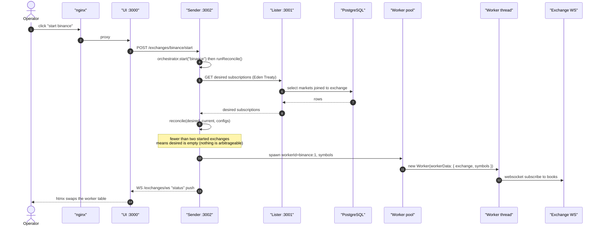
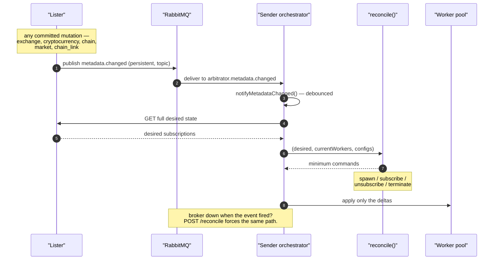
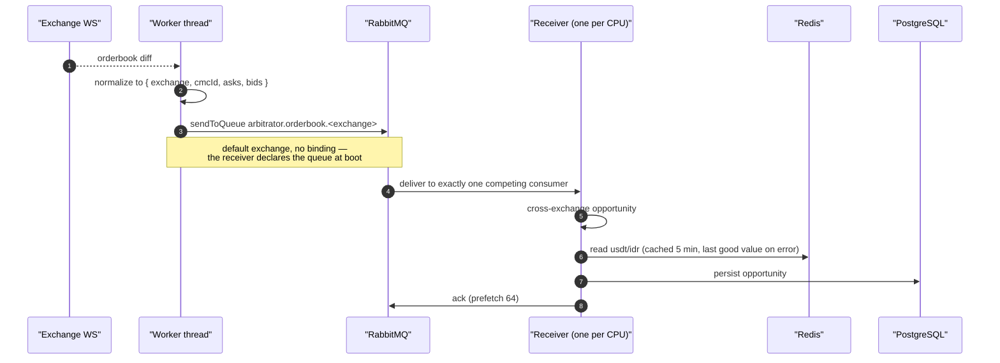
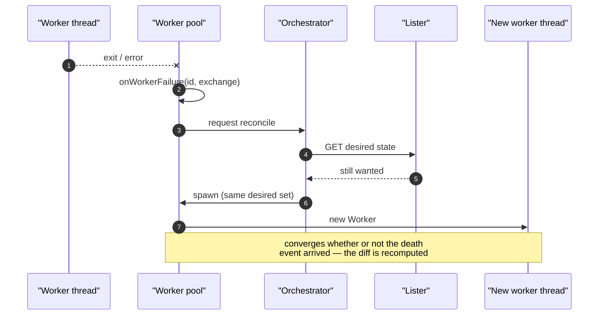
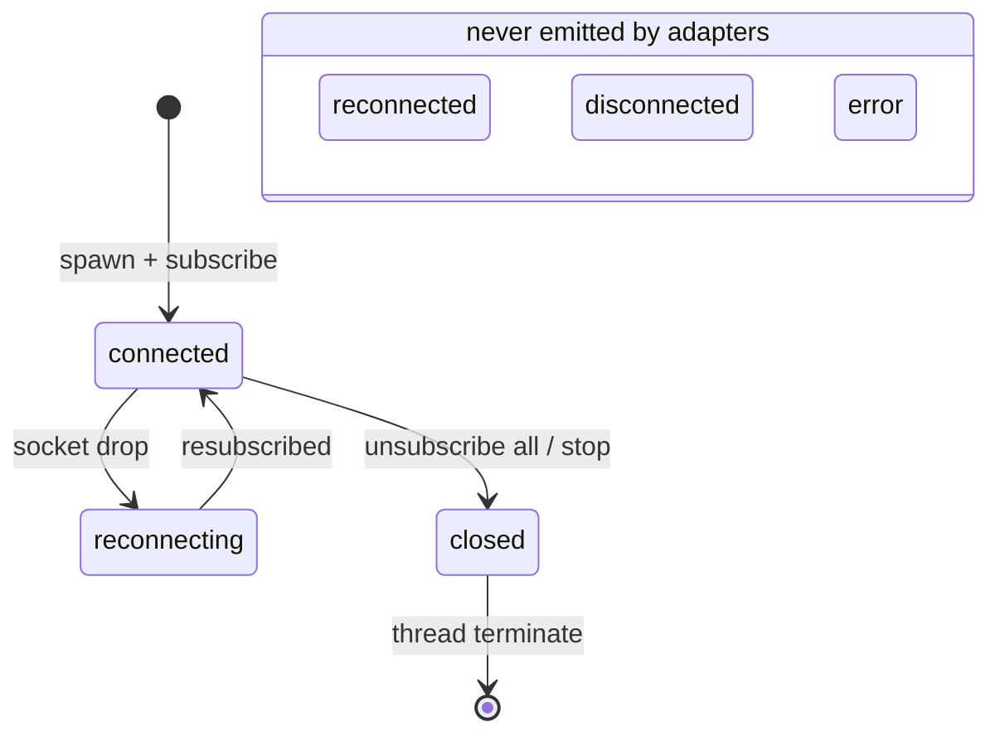
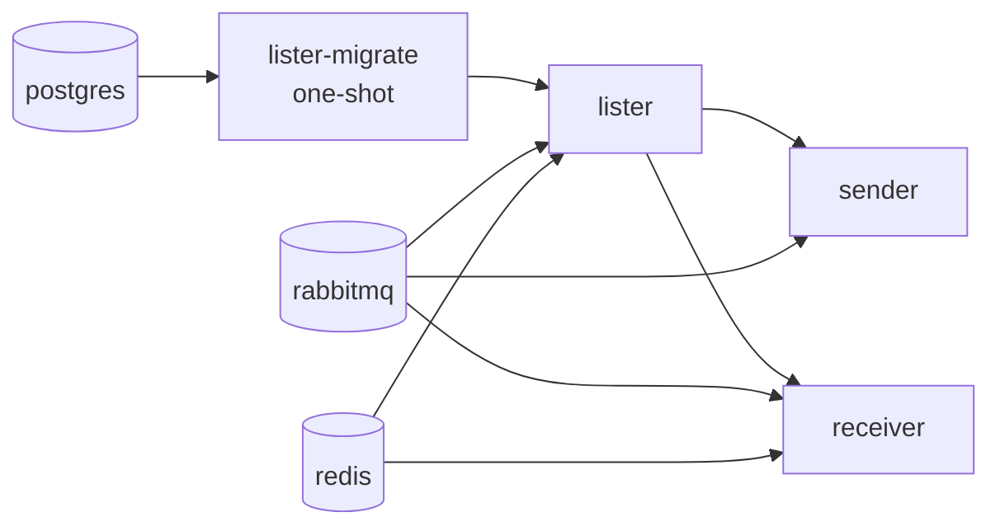

# Runtime flows

Sequence diagrams for the paths that are easy to get wrong. Static structure is
in [`model.c4`](./model.c4); the wire-level broker topology is in
[`topology.md`](./topology.md), which is generated.

Read the ADRs alongside these: [0001 — desired-state
reconciliation](../adr/0001-desired-state-reconciliation.md), [0002 — control vs
data plane](../adr/0002-worker-control-vs-data-plane.md).

## 1. Starting an exchange (control path)

The only way a worker exists is a reconcile. Start is not a special code path —
it flips `startedExchanges`, and the same reconciler does the rest.

## 2. `metadata.changed` → reconcile (ADR 0001)

The event is a **hint**, never a diff. The sender re-reads everything and
converges. That is why a lost event is a latency bug, not a correctness bug.

## 3. Orderbook hot path (data plane)

Worker `postMessage` never carries an orderbook — only control. The payload goes
to RabbitMQ, one durable queue per exchange, so a slow exchange cannot
head-of-line block the others.

## 4. Worker dies

Level-triggered recovery: the pool reports the death, the orchestrator reconciles
from desired state, and a new worker appears if the exchange is still started.

## 5. Worker connection state

`workerStateSchema` has six values, but the adapters only emit three. Treat
`reconnected`, `disconnected` and `error` as legacy enum members until an adapter
starts posting them.

## 6. Boot order

Lister owns the migrations; `deploy.compose.yaml` gates everything on
`lister-migrate` completing and on the three stores being healthy.
