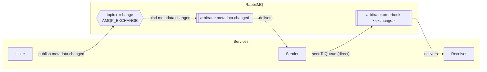

# RabbitMQ topology

<!-- GENERATED by scripts/gen-topology.ts — do not edit by hand. -->

Exchange type `topic`; exchange name comes from `AMQP_EXCHANGE`.

## Routing keys

| Member | Key | Published by | Bound to |
| --- | --- | --- | --- |
| `orderbookNormalizedAll` | `orderbook.normalized.*` | — | — |
| `metadataChanged` | `metadata.changed` | Lister | Sender |

## Queues

| Member | Name | Fed by | Consumed by |
| --- | --- | --- | --- |
| `orderbookFor` | `arbitrator.orderbook.<exchange>` | sender worker threads, `sendToQueue` over the default exchange | Receiver |
| `metadataChanged` | `arbitrator.metadata.changed` | Lister | Sender |

## Notes

- The orderbook path is **not** bound to the topic exchange. Workers call
  `sendToQueue` over the default exchange, straight into
  `arbitrator.orderbook.<exchange>`, which the receiver declares at boot.
- `Queues.orderbook` and `RoutingKeys.orderbookNormalizedAll` belong to the
  legacy `concurrent.ts` entrypoint and are excluded from the diagram.
- Consumer attribution is heuristic: it reads `queue:` / `patterns:` from
  each file. Keep those call shapes stable, or update this script.

